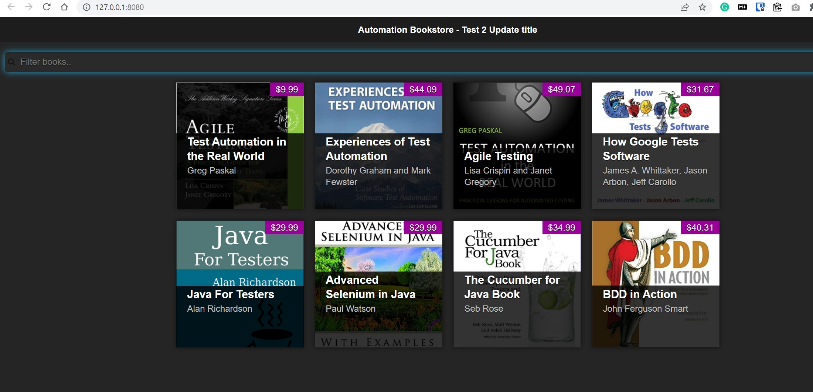
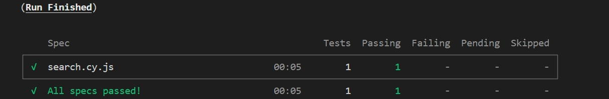

## About

Sample application for test automation.

Site is deployed at https://automationbookstore.dev (https://mzinbookstore-linux.azurewebsites.net) or can be downloaded and used locally.

The app itself is a static site (`index.html` + `css/`, `js/`, `img/`) with no build step.

## Installation

```bash
git clone https://github.com/MaksimZinovev/automation-bookstore-yaml.git
cd automation-bookstore-yaml
```

## Running the site locally

Install [live-server - npm](https://www.npmjs.com/package/live-server):

```bash
npm install live-server -g
```

Install the root dependencies:

```bash
npm install
```

The port the site is served on is defined once, in `.env` at the repository root:

```
PORT=8089
```

Both test suites read that value, so they always target the same server. Serve the site from the repository root, keeping it running in a separate terminal:

```bash
npm run serve
```

Check in your browser that http://127.0.0.1:8089/ is accessible.

To change the port, edit `.env` — nothing else needs to be touched. For a one-off override, export the variable for both the server and the tests; `dotenv` never overwrites an already-set `PORT`:

```bash
PORT=9000 npm run serve     # in one terminal
PORT=9000 npm test          # in another
```

## Tests

Two independent test suites exist in this repository. Both read `PORT` from the root `.env`:

| Suite | Location | Config |
| --- | --- | --- |
| Playwright | `tests/` | `tests/playwright.config.ts` |
| Cypress | `e2e-tests/` | `e2e-tests/cypress.config.js` |

Each suite still has its own `package.json`, so install dependencies inside the respective directory as well.

### Playwright (`tests/`)

Runs the specs in `tests/tests/` on Chromium. The config loads the root `.env` via `dotenv` and builds `baseURL` from `PORT`; specs use relative paths (`page.goto('/')`).

```bash
cd tests
npm install
npx playwright install chromium
npx playwright test bookstore
```

Useful variants:

```bash
npx playwright test              # run all specs in the project
npx playwright test --headed     # watch the browser
npx playwright show-report       # open the HTML report from the last run
```

The HTML report is written to `tests/playwright-report/` (git-ignored).

### Cypress (`e2e-tests/`)

Runs `cypress/e2e/search.cy.js`. The config loads the root `.env` via `dotenv` and sets `baseUrl` from `PORT`, with JUnit results written to `e2e-tests/results/`.

```bash
cd e2e-tests
npm install
npm test            # headless run (cypress run)
npx cypress open    # interactive UI mode
```

Run `search.cy.js` in the Cypress app to check that the setup works.

### Both suites from the root

Once the root and per-suite dependencies are installed:

```bash
npm test                  # Playwright, then Cypress
npm run test:playwright
npm run test:cypress
```

The older `e2e/` directory contains an additional Cypress + Applitools visual-testing project (`search.spec.js`, `search_visual.spec.js`). Its `cypress.json` also targets port 8089, but it is not wired into the root scripts above and needs an `APPLITOOLS_API_KEY` to run.

## Deployment

`azure-pipelines.yml` triggers on pushes to `master`: it archives the static site, publishes the artifact, and deploys it to the `mzinbookstore-linux` Azure Web App.




